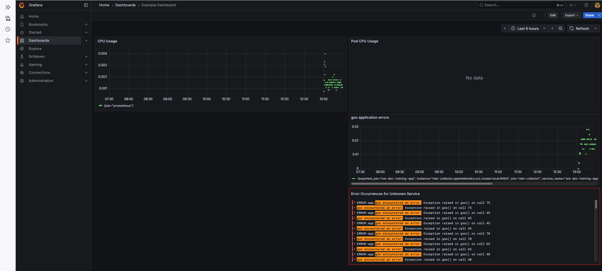
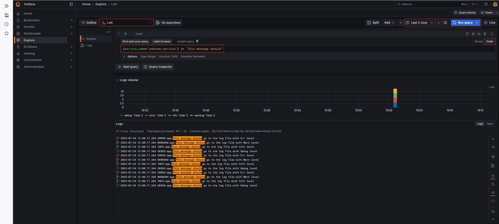

# Application Logging and Observability with OpenTelemetry and Grafana Loki

## Table of Contents

* [Overview](#overview)
* [Understanding the Setup](#understanding-the-setup)

  * [Application Logging with OpenTelemetry](#application-logging-with-opentelemetry)
  * [Shared Log Volume Configuration](#shared-log-volume-configuration)
  * [OpenTelemetry Collector Configuration](#opentelemetry-collector-configuration)
  * [Grafana Loki Setup](#grafana-loki-setup)
  * [Prometheus RBAC Setup](#prometheus-rbac-setup)
  * [Grafana Integration (Datasource & Dashboard)](#grafana-integration-datasource--dashboard)
* [Execution Steps](#execution-steps)
* [Verification](#verification)

---

## **Overview**

In this exercise, we will enable **logging for a Python application** and integrate it with **OpenTelemetry, Loki, and Grafana** to visualize logs. The goal is to capture logs generated by the application, store them in a **shared log volume**, and forward them to **Grafana Loki** for centralized monitoring.

The key components of this setup are:

* **Python Application Logging**: Configured to write logs to `/app/logs/sre-app.log` within its container.
* **Persistent Storage (PVC + PV)**: Ensures logs are available and shared between the application and the OpenTelemetry Collector.
* **OpenTelemetry Collector**: Reads logs from the shared volume and forwards them to **Loki**.
* **Grafana Loki**: Stores logs and provides an interface to query them.
* **Grafana Dashboard**: Visualizes application logs and provides insights, especially for errors.

By the end of this exercise, you will be able to analyze application logs in **Grafana** using Loki as the log backend.


The configurations in this exercise primarily correspond to the blue square in the diagram above, focusing on the logging pipeline.

---

## **Understanding the Setup**

This section describes the key configuration changes and components involved in setting up the logging and observability pipeline. All necessary YAML files are provided in this directory or referenced from other exercise directories.

### **Application Logging with OpenTelemetry**

The Python application's code (`app.py`) has been modified to:

* Use standard Python `logging`.
* Direct logs to `./logs/sre-app.log` inside the container.
* Instrument logging using `opentelemetry-instrumentation-logging` to automatically export logs via OTLP (OpenTelemetry Protocol).

The `Dockerfile` is adjusted to:

* Install the `opentelemetry-instrumentation-logging` library.
* Create the `/app/logs` directory inside the image and set appropriate permissions to ensure the application can write logs.

> See: `app.py` and `Dockerfile` in this directory.

### **Shared Log Volume Configuration**

To allow both the application and the OpenTelemetry Collector to access the same log file, a shared volume is used:

* **Minikube Host Directory**: A directory `/data/sre-app/logs` is created on the Minikube VM's host filesystem. This directory acts as the shared location.
* **Persistent Volumes (PVs)**: Two `hostPath` Persistent Volumes (`log-pv-1` and `log-pv-2`) are defined, pointing to the `/data/sre-app/logs` directory on the Minikube node.
* **Persistent Volume Claims (PVCs)**:

  * `log-pvc` in the `application` namespace claims `log-pv-1` and is mounted into the application's container at `/app/logs`.
  * `log-pvc` in the `opentelemetry` namespace claims `log-pv-2` and is mounted into the OpenTelemetry Collector's container at `/var/log/sre-app`.

> See: `storage.yaml` and `deployment.yaml`.

### **OpenTelemetry Collector Configuration**

The OpenTelemetry Collector (`otel-collector.yaml`) is configured to:

* Mount the shared log volume (`log-pvc` from `opentelemetry` namespace) at `/var/log/sre-app`.
* Use a `filelog` receiver to tail log files within `/var/log/sre-app/*.log`.
* Utilize an `otlphttp/loki` exporter to forward collected logs to the Loki service.
* Configure a `logs` pipeline that routes logs from the `filelog` receiver to the `otlphttp/loki` exporter.

> See: `otel-collector.yaml`.

### **Grafana Loki Setup**

Grafana Loki is deployed as the centralized log aggregation system. The OpenTelemetry Collector sends logs to Loki, making them available for querying by Grafana.

> See: `grafana-loki.yaml`.

### **Prometheus RBAC Setup**

For Prometheus to effectively discover and scrape metrics from all components across the cluster (including `cadvisor` and other Kubernetes-internal targets), it requires specific cluster-wide permissions. This is granted via:

* A `ClusterRole` named `prometheus-pod-reader-cluster` with `get`, `list`, and `watch` permissions on `pods` and `endpoints`.
* A `ClusterRoleBinding` that binds this `ClusterRole` to the `default` ServiceAccount in the `monitoring` namespace, which the Prometheus pod uses.

> See: `prometheus-rbac-cluster.yaml`.

### **Grafana Integration (Datasource & Dashboard)**

Grafana is configured to:

* Add a new `Loki` datasource, pointing to `http://loki.opentelemetry.svc.cluster.local:3100`.
* Include an example dashboard that features a panel specifically designed to display error logs by querying Loki for entries containing `"goo encountered an error:"`.

> The panel titled **“Error Occurrences for Unknown Service”** is part of the Example Dashboard in Grafana and helps identify error trends.

> See: `grafana.yaml`.

---

## **Execution Steps**

1. **Navigate to the Exercise Directory:**

   ```bash
   cd sre-academy-training/exercises/exercise10
   ```

2. **Run the Deployment Script:**

   This script will perform a complete cleanup of previous Minikube/Colima states, start a fresh Minikube cluster, build your application image, and deploy all Kubernetes resources.

   ```bash
   ./cluster.sh
   ```

   *Note: This may take several minutes on the first run.*

---

## **Validate Logs in Grafana (Loki)**

1. Go to **Explore** in the Grafana sidebar.

2. Select the **`Loki`** data source from the dropdown.

3. In the query field, paste the following code:

   ```logql
   {service_name="unknown_service"} |= "This message should"
   ```

4. Click **Run query**.

You should now see logs for all levels: `DEBUG`, `INFO`, `WARNING`, and `ERROR` — confirming that Loki is collecting logs from your app.

---

## **Final Objective**

By completing this exercise, you should be able to:

* View **trace-based logs** using **Grafana Explore**.
* Use **Loki** as a centralized log aggregator.
* Filter and identify logs by **log level** (e.g., `debug`, `info`, `warning`, `error`).
* Analyze log **volume and frequency over time** using built-in visualizations.

### Example Output

* **Log Volume Graph**

  This graph displays the volume of logs over time, grouped by severity. It helps visualize when peaks in logging activity occur and whether specific levels (like `ERROR`) spike unexpectedly.

  

* **Logs Table with Highlighted Entries**

  This panel shows a list of structured logs captured by Loki. You can see multiple log levels (`DEBUG`, `INFO`, `WARNING`, `ERROR`) with the message:

  
---