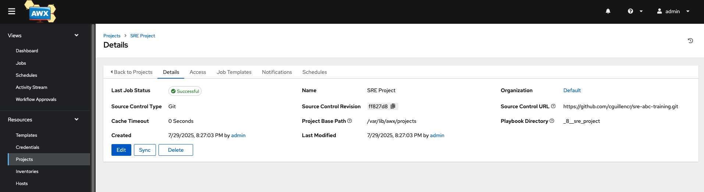
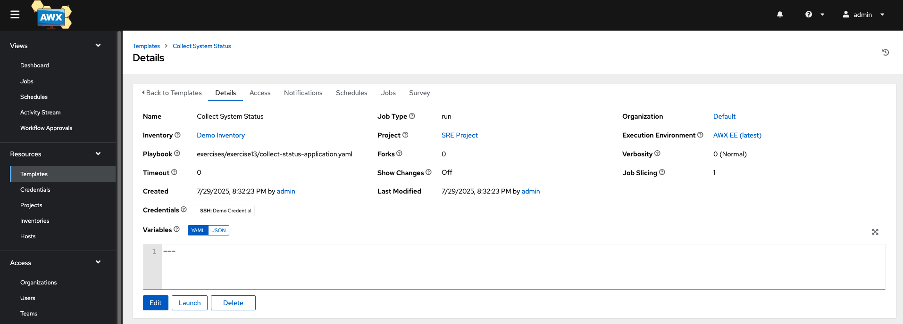
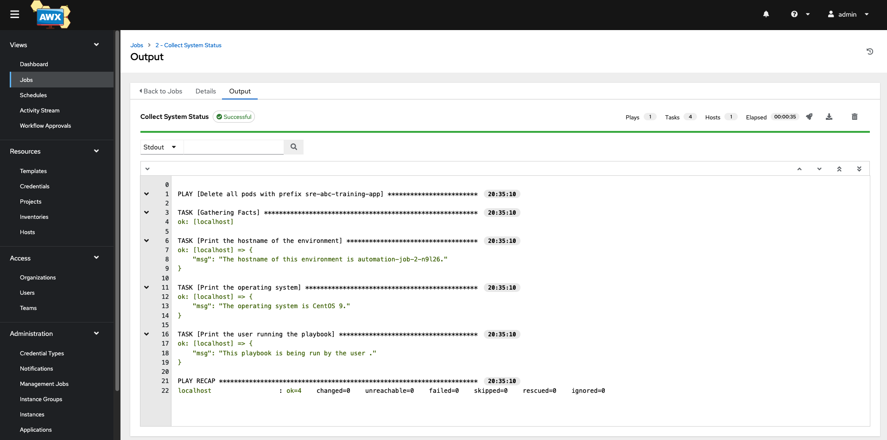
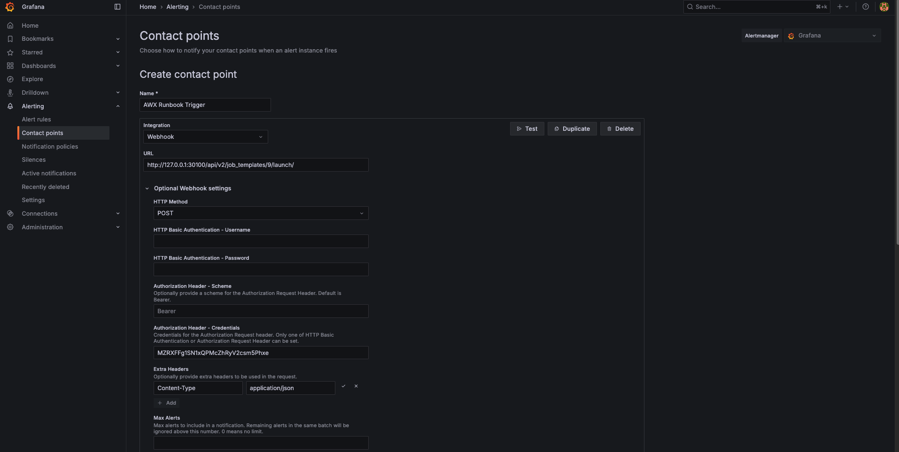
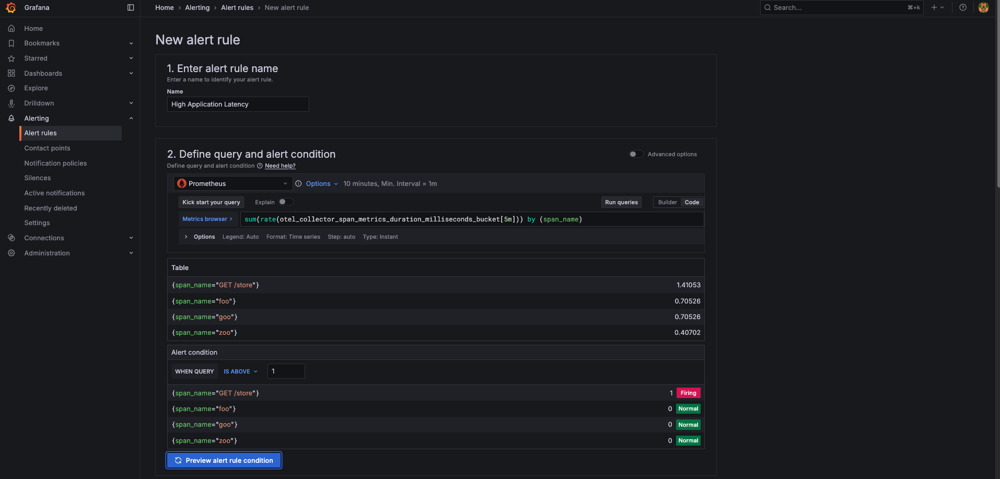
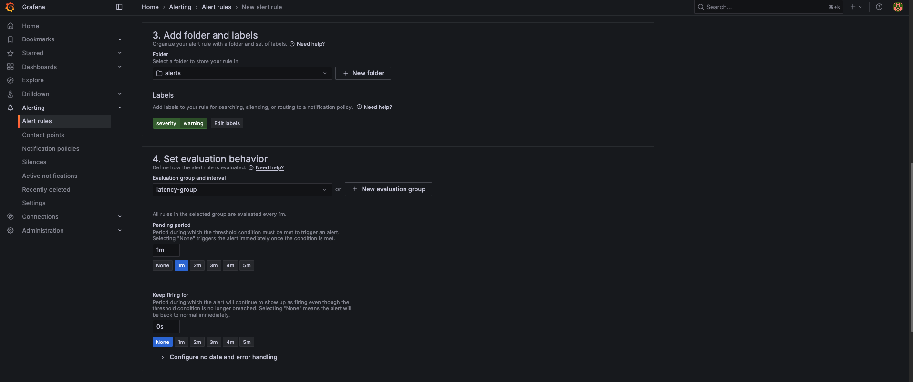
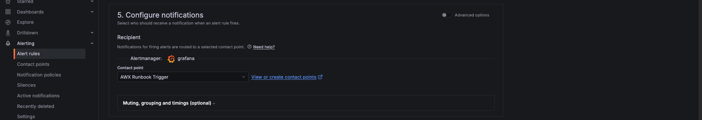
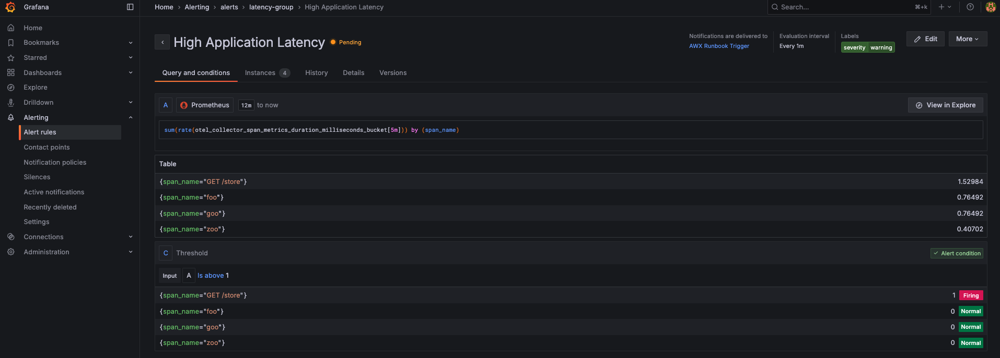
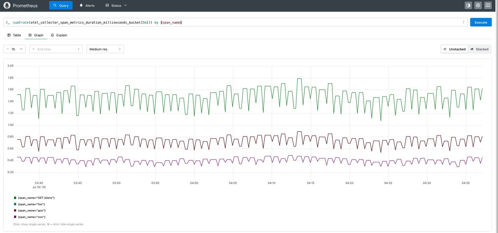

# Automating Incident Response with AWX and Grafana

## Table of Contents

- [Learning Objectives](#learning-objectives)
- [Navigate to the Directory](#navigate-to-the-directory)
- [Part 1: Deploy Infrastructure](#part-1-deploy-infrastructure)
- [Part 2: Configure AWX Project and Runbook](#part-2-configure-awx-project-and-runbook)
- [Part 3: API Integration Setup](#part-3-api-integration-setup)
- [Part 4: Configure Grafana Alerting](#part-4-configure-grafana-alerting)
- [Part 5: Test End-to-End Automation](#part-5-test-end-to-end-automation)
- [Troubleshooting](#troubleshooting)
- [Final Objective](#final-objective)
- [Next Steps](#next-steps)

---

## Learning Objectives

By the end of this exercise, you will:

- Understand automated runbook execution concepts
- Deploy AWX in a Kubernetes environment
- Create and execute Ansible runbooks through AWX
- Configure Grafana alerts to trigger AWX jobs automatically
- Implement end-to-end automated incident response

---

## Navigate to the Directory

Before proceeding, navigate to the correct directory:

```bash
cd sre-academy-training/exercises/exercise13
```

---

## Part 1: Deploy Infrastructure

### Step 1: Automated Deployment

Run the provided script to deploy the complete infrastructure:

```bash
./cluster.sh --start
```

**What this does:**

- Starts a fresh Minikube cluster with increased resources
- Deploys the AWX Operator and AWX instance
- Installs the observability stack: Prometheus, Grafana, Jaeger, Loki, and OpenTelemetry Collector
- Deploys the sample application for monitoring

> ⚠️ **Important:** `./cluster.sh --start` is destructive. It deletes existing Minikube profiles before recreating the environment.

### Step 2: Verify Deployment

Wait for the script to complete, then verify that the workloads are running:

```bash
kubectl get pods -A
```

Expected output should include pods similar to:

```text
NAMESPACE       NAME                                      READY   STATUS
awx             awx-demo-web-xxxxx                       3/3     Running
awx             awx-demo-task-xxxxx                      4/4     Running
awx             awx-demo-postgres-15-0                   1/1     Running
monitoring      grafana-deployment-xxxxx                 1/1     Running
monitoring      prometheus-deployment-xxxxx              1/1     Running
opentelemetry   otel-collector-xxxxx                     1/1     Running
opentelemetry   jaeger-xxxxx                             1/1     Running
opentelemetry   loki-xxxxx                               1/1     Running
application     sre-abc-training-app-xxxxx               1/1     Running
```

If some pods are still in `ContainerCreating`, `Pending`, or `Running` but not fully ready, wait another two or three minutes and run:

```bash
kubectl get pods -A
```

### Step 3: Extract AWX Credentials

Retrieve the AWX administrator password and save it for later:

```bash
kubectl get secret awx-demo-admin-password \
  -n awx \
  -o jsonpath="{.data.password}" | base64 --decode ; echo
```

AWX administrator credentials:

```text
Username: admin
Password: <output from the command above>
```

### Step 4: Access the AWX UI

Open a **new terminal window** and run:

```bash
minikube service awx-demo-service -n awx --url
```

Minikube prints a local URL similar to:

```text
http://127.0.0.1:53331
```

Open the printed URL in your browser.

> ⚠️ **Keep the terminal open.** With the Docker driver on macOS and WSL2, Minikube may create a temporary local tunnel. Closing the terminal that runs `minikube service ... --url` can stop access to AWX. Run the command again if you need a new URL.

Log in using:

```text
Username: admin
Password: <AWX administrator password from Step 3>
```

> ⚠️ **Common issues**
>
> - If AWX pods are `Pending`, wait two or three minutes for resources to allocate.
> - If the URL does not respond, verify the AWX workloads:
>
>   ```bash
>   kubectl get pods -n awx
>   ```
>
> - If the terminal running `minikube service ... --url` was closed, run the command again and use the newly printed URL.

---

## Part 2: Configure AWX Project and Runbook

### Step 5: Create AWX Project

1. Access the **AWX Web UI** using the URL from Step 4.
2. Log in as `admin`.
3. Navigate to **Projects** and click **+ Add**.
4. Configure the project:

| Field | Value |
|---|---|
| Name | `SRE Project` |
| Organization | `Default` |
| Source Control Type | `Git` |
| Source Control URL | `https://github.com/cguillencr/sre-abc-training.git` |
| Source Control Branch/Tag/Commit | Leave blank to use the default branch |

5. Leave the remaining fields unchanged and click **Save**.

> The repository is public and read-only. Students do not need to push changes or configure Git credentials.

> **Why not use an IBM internal repository?**
>
> - Students without VPN access could not complete the exercise.
> - Private repositories require credentials, SSH keys, or GitHub App configuration.
> - The lab content is static, so a public repository is sufficient.

> Example project configuration:
>
> 

### Step 6: Create Runbook Job Template

1. Navigate to **Templates**.
2. Click **+ Add** and select **Job Template**.
3. Configure the template:

| Field | Value |
|---|---|
| Name | `Collect System Status` |
| Job Type | `Run` |
| Inventory | `Demo Inventory` |
| Project | `SRE Project` |
| Playbook | `exercises/exercise13/collect-status-application.yaml` |
| Credential | `Demo Credential` |

4. Click **Save**.

> Example job template:
>
> 

### Step 7: Test Manual Execution

1. Find the `Collect System Status` template in the Templates list.
2. Click the rocket icon (🚀) to launch it.
3. Open the resulting job.
4. Verify that the job completes with a green successful status.

Expected result: the job completes successfully and shows diagnostic information in its output.

> Example job list:
>
> 

> **Note:** If the job is successful but output is not immediately displayed, refresh the AWX page. AWX can delay log rendering in the UI.

### Deep Dive: Understanding the Runbook

The runbook collects diagnostic information for incident response:

```yaml
---
- name: Collect System Diagnostics for Incident Response
  hosts: localhost
  gather_facts: yes

  tasks:
    - name: Get system uptime
      command: uptime
      register: system_uptime

    - name: Check disk usage
      command: df -h
      register: disk_usage

    - name: Get running processes
      command: ps aux --sort=-%cpu | head -20
      register: top_processes

    - name: Check Kubernetes pod status
      command: kubectl get pods -A
      register: k8s_pods
      ignore_errors: yes

    - name: Display collected information
      debug:
        msg: |
          === INCIDENT RESPONSE DIAGNOSTICS ===
          System Uptime: {{ system_uptime.stdout }}

          Top CPU Processes:
          {{ top_processes.stdout }}

          Kubernetes Status:
          {{ k8s_pods.stdout }}
```

Why this matters for SRE work:

- **Standardized response:** Every incident receives the same initial diagnostic collection.
- **Time savings:** Responders do not need to manually run routine commands.
- **Documentation:** AWX records the execution and output.
- **Consistency:** The runbook reduces manual variation during an incident.

---

## Part 3: API Integration Setup

### Step 8: Create API Application

1. In AWX, navigate to **Administration** → **Applications**.
2. Click **+ Add**.
3. Configure the application:

| Field | Value |
|---|---|
| Name | `Grafana Integration` |
| Organization | `Default` |
| Authorization Grant Type | `Resource owner password-based` |
| Client Type | `Confidential` |

4. Click **Save**.
5. Copy the generated Client ID and Client Secret.

> ℹ️ The client secret is shown only once. Store it securely if you need it later.

### Step 9: Generate a Personal API Token

1. Go to **Access** → **Users**.
2. Select the `admin` user.
3. Open **Tokens**.
4. Click **+ Add**.
5. Configure the token:

| Field | Value |
|---|---|
| Application | `Grafana Integration` |
| Scope | `Write` |

6. Click **Save**.
7. Copy the token value.

> ℹ️ The token value and refresh token are only displayed once. Store them securely. You cannot retrieve the token value later.

### Step 10: Test API Access

Open a **new terminal window** for API testing.

First, in another terminal, start or keep running the AWX service tunnel:

```bash
minikube service awx-demo-service -n awx --url
```

Copy the URL that Minikube prints, then set your variables:

```bash
export AWX_TOKEN="your_token_here"
export AWX_URL="http://127.0.0.1:<random-port>"
```

> **Important:** Keep the terminal running `minikube service awx-demo-service -n awx --url` open while running the API commands below. Closing it can stop the local URL.
>
> The port is dynamically assigned and can differ between students or after restarting the service command. Use the full URL exactly as Minikube prints it.

Test connectivity and authentication:

```bash
curl -s \
  -H "Authorization: Bearer $AWX_TOKEN" \
  -H "Content-Type: application/json" \
  "$AWX_URL/api/v2/me/" | jq '.results[] | {id, username, is_superuser}'
```

You should receive JSON containing your user details, similar to:

```json
{
  "id": 1,
  "username": "admin",
  "is_superuser": true
}
```

### Deep Dive: AWX REST API

The AWX API allows external systems such as Grafana, PagerDuty, scripts, and custom applications to interact with automation resources.

#### List all job templates

```bash
curl -s \
  -H "Authorization: Bearer $AWX_TOKEN" \
  "$AWX_URL/api/v2/job_templates/" \
  | jq '.results[] | {id, name}'
```

> Job template IDs differ between environments. Use the ID from your own `Collect System Status` template in later commands.

#### Launch a job

Replace `YOUR_ID` with the Job Template ID from the prior command:

```bash
curl -s \
  -X POST \
  -H "Authorization: Bearer $AWX_TOKEN" \
  -H "Content-Type: application/json" \
  -d '{}' \
  "$AWX_URL/api/v2/job_templates/YOUR_ID/launch/" \
  | jq '{job, status}'
```

Example response:

```json
{
  "job": 5,
  "status": "pending"
}
```

#### Monitor a job

Replace `YOUR_JOB_ID` with the job ID returned by the launch request:

```bash
curl -s \
  -H "Authorization: Bearer $AWX_TOKEN" \
  "$AWX_URL/api/v2/jobs/YOUR_JOB_ID/" \
  | jq '.status'
```

A successful job normally transitions through:

```text
pending → running → successful
```

Why API automation matters:

- **Integration:** Other systems can trigger runbooks.
- **Programmatic control:** Automation can run without requiring a user to click through the AWX UI.
- **Scalability:** The same pattern can support many automated workflows.

This manual API test confirms that AWX is reachable, token authentication works, and a runbook can be launched programmatically before connecting Grafana alerting.

---

## Part 4: Configure Grafana Alerting

### Step 11: Access Grafana

Open a **new terminal window** and run:

```bash
minikube service grafana-service -n monitoring --url
```

Minikube prints a local URL similar to:

```text
http://127.0.0.1:54321
```

Open the printed URL in your browser.

> ⚠️ Keep the terminal running while you use Grafana. With the Docker driver on macOS and WSL2, Minikube may use a local tunnel that stops when the command exits or the terminal closes.

Default Grafana credentials:

```text
Username: admin
Password: admin
```

### Step 12: Create Webhook Contact Point

Grafana runs **inside Kubernetes**, so it must call AWX through the internal Kubernetes Service address—not through the browser-facing `127.0.0.1` URL.

1. In Grafana, navigate to **Alerting** → **Contact points**.
2. Click **+ Add contact point**.
3. Configure it:

| Field | Value |
|---|---|
| Name | `AWX Runbook Trigger` |
| Integration | `Webhook` |
| URL | `http://awx-demo-service.awx.svc.cluster.local:80/api/v2/job_templates/YOUR_ID/launch/` |
| HTTP Method | `POST` |

Replace `YOUR_ID` with the ID of your `Collect System Status` Job Template.

4. Configure authorization:

| Field | Value |
|---|---|
| Authorization Header Scheme | `Bearer` |
| Credentials | Your AWX personal API token from Step 9 |

5. Add an extra HTTP header:

| Key | Value |
|---|---|
| `Content-Type` | `application/json` |

6. Click **Save**.

> **Why use an internal Service URL?**
>
> Grafana runs in the `monitoring` namespace. Inside the Grafana Pod, `127.0.0.1` points back to Grafana itself—not to your laptop, the Minikube host, or AWX.
>
> Kubernetes service DNS provides a stable in-cluster address:
>
> ```text
> http://awx-demo-service.awx.svc.cluster.local:80
> ```
>
> This works consistently for macOS, Ubuntu Linux, and WSL2 because the request stays within the Kubernetes cluster.

> Example Grafana webhook contact point:
>
> 

### Step 13: Create Alert Rule

1. In Grafana, navigate to **Alerting** → **Alert rules**.
2. Click **+ New alert rule**.

#### Enter alert rule name

Set the name to:

```text
High Application Latency
```

#### Define the query and condition

1. Select the Prometheus datasource.
2. Click the **Code** tab in the query editor.
3. Enter this PromQL query:

```promql
sum(rate(otel_collector_span_metrics_duration_milliseconds_bucket[5m])) by (span_name)
```

4. Configure the evaluation interval as `1m`.
5. Configure the alert condition:

| Field | Value |
|---|---|
| WHEN | Query |
| IS ABOVE | `1` |

> Example alert query:
>
> 

#### Add folder and labels

Select or create a folder:

```text
alerts
```

Add labels:

| Label | Value |
|---|---|
| `severity` | `warning` |

#### Configure evaluation behavior

| Field | Value |
|---|---|
| Evaluation group | `latency-group` |
| Evaluation interval | `1m` |
| Pending period | `1m` |
| Keep firing | `0s` |

> Example evaluation behavior:
>
> 

#### Configure notifications

1. Select **Alertmanager (Grafana-managed)** as the recipient system.
2. Select the contact point:

```text
AWX Runbook Trigger
```

3. Save the alert rule.

> Example notification configuration:
>
> 

> Example successful alert rule:
>
> 

### Deep Dive: Understanding the Alert Query

```promql
sum(rate(otel_collector_span_metrics_duration_milliseconds_bucket[5m])) by (span_name)
```

Breakdown:

```text
otel_collector_span_metrics_duration_milliseconds_bucket
  → OpenTelemetry histogram bucket metric for request duration

rate(...[5m])
  → Calculates the per-second rate over the last five minutes

sum(...) by (span_name)
  → Aggregates the rate by operation/span name
```

This query measures the rate of request-duration histogram bucket observations for each operation. In this learning exercise, the rule fires when the query value exceeds `1`.

### Deep Dive: Webhook Integration

When the Grafana alert fires, Grafana makes a request similar to:

```bash
curl \
  -X POST \
  -H "Authorization: Bearer YOUR_AWX_TOKEN" \
  -H "Content-Type: application/json" \
  -d '{
    "receiver": "AWX Runbook Trigger",
    "status": "firing",
    "alerts": [
      {
        "status": "firing",
        "labels": {
          "alertname": "High Application Latency",
          "span_name": "http_request"
        },
        "annotations": {
          "summary": "Application latency is above threshold"
        }
      }
    ]
  }' \
  "http://awx-demo-service.awx.svc.cluster.local:80/api/v2/job_templates/YOUR_ID/launch/"
```

Replace:

- `YOUR_AWX_TOKEN` with your AWX API token
- `YOUR_ID` with the Job Template ID for `Collect System Status`

The automation chain is:

1. Application experiences high latency or elevated traffic.
2. OpenTelemetry captures telemetry.
3. Prometheus stores and exposes metrics.
4. Grafana evaluates the alert rule.
5. Grafana sends the webhook to AWX.
6. AWX launches the diagnostic runbook.
7. Incident responders review the AWX job output.

---

## Part 5: Test End-to-End Automation

### Observe the Full Pipeline

Use multiple terminals to observe alerting and automation activity.

#### Terminal 1: Watch AWX jobs

```bash
while true; do
  clear
  kubectl get jobs -n awx
  sleep 2
done
```

Look for new `automation-job-*` Jobs after an alert fires.

#### Terminal 2: View AWX job logs

Find the job pod:

```bash
kubectl get pods -n awx | grep automation-job
```

Stream its logs:

```bash
kubectl logs -n awx POD_NAME -f
```

Replace `POD_NAME` with the actual Pod name.

> These Pods are short-lived. If the job completes quickly, run the first command again to identify a later job.

#### Terminal 3: View Prometheus metrics

Run this command in a dedicated terminal:

```bash
kubectl port-forward -n monitoring svc/prometheus-service 9090:9090
```

Keep the terminal open, then visit:

[http://127.0.0.1:9090](http://127.0.0.1:9090)

Run this PromQL query:

```promql
sum(rate(otel_collector_span_metrics_duration_milliseconds_bucket[5m])) by (span_name)
```

> Example Prometheus query:
>
> 

#### Terminal 4: Watch AWX automation Pods

```bash
while true; do
  clear
  kubectl get pods -n awx | grep automation-job
  sleep 2
done
```

The Pod typically transitions through:

```text
Pending → Running → Completed → deleted
```

### Trigger the Alert

Trigger application degradation:

```bash
kubectl exec \
  -n application \
  deployment/sre-abc-training-app \
  -- curl -X POST http://localhost:8080/degrade
```

Or simulate application load:

```bash
for i in {1..100}; do
  kubectl exec \
    -n application \
    deployment/sre-abc-training-app \
    -- curl http://localhost:8080/api/data &
done
```

### Success Criteria

| Event | Expected result |
|---|---|
| Metric spike | Prometheus shows increased telemetry values |
| Alert firing | Grafana displays a firing alert |
| AWX trigger | A new `automation-job-*` Job appears in the `awx` namespace |
| Runbook output | AWX job logs show Ansible execution and diagnostics |
| Cleanup | The short-lived automation Pod completes and is eventually removed |

---

## Troubleshooting

### AWX is not accessible

Get a fresh AWX URL:

```bash
minikube service awx-demo-service -n awx --url
```

Keep that terminal open while using the URL.

Check AWX Pods:

```bash
kubectl get pods -n awx
```

Describe AWX Pods:

```bash
kubectl describe pod -n awx -l app.kubernetes.io/name=awx-demo
```

View AWX Web logs:

```bash
kubectl logs -n awx -l app.kubernetes.io/component=web
```

### AWX API calls are failing

Set your browser-facing AWX variables:

```bash
export AWX_URL="http://127.0.0.1:<random-port>"
export AWX_TOKEN="your_token_here"
```

Test basic connectivity:

```bash
curl -v "$AWX_URL/api/v2/"
```

Test authentication:

```bash
curl -H "Authorization: Bearer $AWX_TOKEN" "$AWX_URL/api/v2/me/"
```

List Job Templates:

```bash
curl \
  -H "Authorization: Bearer $AWX_TOKEN" \
  "$AWX_URL/api/v2/job_templates/" \
  | jq '.results[] | {id, name}'
```

Launch a Job Template:

```bash
curl \
  -X POST \
  -H "Authorization: Bearer $AWX_TOKEN" \
  -H "Content-Type: application/json" \
  -d '{}' \
  "$AWX_URL/api/v2/job_templates/YOUR_ID/launch/"
```

### Grafana alert does not trigger AWX

Verify that Grafana can reach AWX through Kubernetes internal DNS:

```bash
kubectl exec \
  -n monitoring \
  deployment/grafana-deployment \
  -- curl -v http://awx-demo-service.awx.svc.cluster.local:80/api/v2/
```

Test the AWX webhook endpoint from the Grafana Pod:

```bash
kubectl exec \
  -n monitoring \
  deployment/grafana-deployment \
  -- curl \
    -X POST \
    -H "Authorization: Bearer YOUR_TOKEN" \
    -H "Content-Type: application/json" \
    -d '{}' \
    http://awx-demo-service.awx.svc.cluster.local:80/api/v2/job_templates/YOUR_ID/launch/
```

Check Grafana logs for webhook errors:

```bash
kubectl logs \
  -n monitoring \
  deployment/grafana-deployment \
  | grep -i webhook
```

### Prometheus metrics are missing

Check that the OpenTelemetry Collector is running:

```bash
kubectl get pods -n opentelemetry
```

Inspect OpenTelemetry metrics:

```bash
kubectl exec \
  -n opentelemetry \
  deployment/otel-collector \
  -- curl http://localhost:8889/metrics \
  | grep otel_collector_span
```

Verify that the application is generating telemetry:

```bash
kubectl logs \
  -n application \
  deployment/sre-abc-training-app
```

### Grafana is not accessible

Get a fresh Grafana URL:

```bash
minikube service grafana-service -n monitoring --url
```

Keep the terminal open while using the printed URL.

Check Grafana status:

```bash
kubectl get pods -n monitoring
kubectl logs -n monitoring deployment/grafana-deployment --tail=200
```

---

## Final Objective

By completing this exercise, you have implemented an automated incident-response workflow triggered by Grafana alerts.

The workflow:

1. Detects an application condition through telemetry and metrics.
2. Evaluates the condition in Grafana.
3. Triggers an AWX runbook through a secured webhook.
4. Collects diagnostics automatically.
5. Stores execution output in AWX for responders to review.

This workflow improves incident response by:

- Collecting diagnostic information quickly
- Reducing manual intervention
- Creating consistent, repeatable automation
- Recording response actions and output
- Connecting observability systems with operational runbooks

Example alert state:


Example AWX Job executions:


---

## Next Steps

In [Exercise 14](../exercise14), you will conduct an Operational Readiness Review and evaluate whether the environment meets production-oriented operational expectations.

You should now be confident with:

- Deploying AWX and configuring Job Templates through the UI and API
- Configuring Grafana alerting and webhook contact points
- Writing and executing diagnostic Ansible runbooks
- Testing alert-triggered automation
- Troubleshooting Kubernetes, Prometheus, Grafana, and AWX integration
