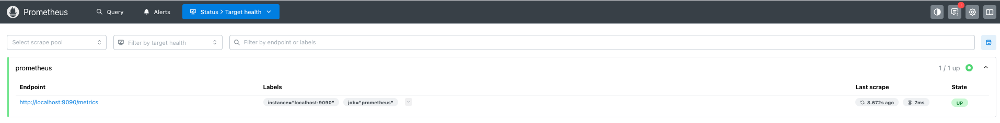

# Deploying Prometheus in Minikube

## Table of Contents

- [Navigate to the Application Directory](#navigate-to-the-application-directory)
- [Overview](#overview)
- [Key Features of Prometheus](#key-features-of-prometheus)
- [Architecture](#architecture)
- [Use Cases](#use-cases)
- [Traditional Installation](#traditional-installation)
- [Prometheus Installation Steps](#prometheus-installation-steps)
  - [Step 1: Namespace Creation](#step-1-namespace-creation)
  - [Step 2: Prometheus Configuration](#step-2-prometheus-configuration)
  - [Step 3: Prometheus Deployment](#step-3-prometheus-deployment)
  - [Step 4: Prometheus Service](#step-4-prometheus-service)
  - [Step 5: Verify Prometheus Configuration](#step-5-verify-prometheus-configuration)
- [Running the Playbook](#running-the-playbook)
- [Final Objective](#final-objective)

-----

## Navigate to the Application Directory

To begin, navigate to the directory for Exercise 5:

```bash
cd sre-academy-training/exercises/exercise5
```

> **Note**: This directory contains the necessary YAML files for the deployment and service configuration.

-----

## Overview

Prometheus is an open-source systems monitoring and alerting toolkit. This exercise demonstrates deploying Prometheus in Minikube using YAML manifests and automating the process with an Ansible playbook.

-----

## Key Features of Prometheus

  - **Time Series Data Storage**: Stores data as time series with metric names and key-value pairs.
  - **Powerful Query Language**: Allows flexible and efficient data retrieval.
  - **Dynamic Service Discovery**: Discovers monitoring targets dynamically.
  - **Integrated Alerting**: Built-in support for alert rules and notifications.
  - **Visualization**: Includes basic visualization with integration options for Grafana.

-----

## Architecture

Prometheus consists of the following components:

  - **Prometheus Server**: Collects and stores data.
  - **Exporters**: Expose metrics to Prometheus.
  - **Alertmanager**: Handles alerts generated by Prometheus.
  - **Pushgateway**: For short-lived jobs pushing metrics.
  - **Client Libraries**: Instrument applications for custom metrics.

-----

## Use Cases

  - Infrastructure Monitoring.
  - Application Performance Monitoring.
  - Alerting for system failures.
  - Microservices-based architecture monitoring.

-----

## Traditional Installation

This section provides the traditional steps to install Prometheus on macOS using Homebrew:

1.  **Install Prometheus via Homebrew**:
    ```bash
    brew install prometheus
    ```
2.  **Locate Configuration File**: By default, Homebrew installs Prometheus configuration to `/opt/homebrew/etc/prometheus.yml` (for Apple Silicon) or `/usr/local/etc/prometheus.yml` (for Intel Macs). You can find the exact location by running `brew info prometheus`.
3.  **Start Prometheus**:
    ```bash
    brew services start prometheus
    ```
    Alternatively, to run it once without backgrounding:
    ```bash
    prometheus --config.file=/opt/homebrew/etc/prometheus.yml # Adjust path if different
    ```

In this exercise, we’ll focus on deploying Prometheus within a Minikube cluster using Kubernetes YAML configurations, which offers a cloud-native approach to monitoring.

-----

## Prometheus Installation Steps

> **Note**: Before proceeding, ensure that both Minikube and Podman are running. These were set up in previous exercises.

The `prometheus.yaml` file required for this exercise is already included in the directory. You do not need to create this file manually. The file contains configurations for the namespace, ConfigMap, deployment, and service for Prometheus.

-----

### Step 1: Namespace Creation

To isolate monitoring tools, create a dedicated namespace in the `prometheus.yaml` file:

```yaml
apiVersion: v1
kind: Namespace
metadata:
  name: monitoring # A separate namespace for all monitoring tools
```

-----

### Step 2: Prometheus Configuration

The Prometheus configuration is defined as a ConfigMap in the `prometheus.yaml` file:

```yaml
apiVersion: v1
kind: ConfigMap
metadata:
  name: prometheus-config
  namespace: monitoring
  labels:
    app: prometheus
data:
  prometheus.yml: |
    global:
      scrape_interval: 15s

    scrape_configs:
      - job_name: 'prometheus'
        static_configs:
          - targets: ['localhost:9090']
```

-----

### Step 3: Prometheus Deployment

The deployment for Prometheus is specified in the `prometheus.yaml` file:

```yaml
apiVersion: apps/v1
kind: Deployment
metadata:
  name: prometheus-deployment
  namespace: monitoring
  labels:
    app: prometheus
spec:
  replicas: 1
  ...
```

-----

### Step 4: Prometheus Service

Expose Prometheus using the following service configuration in the `prometheus.yaml` file:

```yaml
apiVersion: v1
kind: Service
metadata:
  name: prometheus-service
  namespace: monitoring
  labels:
    app: prometheus
spec:
  selector:
    app: prometheus
  ports:
    - protocol: TCP
      port: 9090
      targetPort: 9090
  type: NodePort
```

-----

### Step 5: Verify Prometheus Configuration

After ensuring that the `prometheus.yaml` file is correctly set up, run the following commands to deploy Prometheus and expose the service:

```bash
kubectl apply -f prometheus.yaml
```

Verify the status of the Prometheus pods:

```bash
kubectl get pods -n monitoring
```

Ensure that the pods are in the `Running` state. If not, check the logs or events for troubleshooting.

Expose the Prometheus service using Minikube:

```bash
minikube service prometheus-service -n monitoring
```

-----

## Running the Playbook

While the previous steps guided you through applying Kubernetes configurations manually with `kubectl`, this section demonstrates a more **automated and scalable approach** using Ansible. This is where the principles of **Infrastructure as Code (IaC)** come into play, allowing you to define and manage your infrastructure (in this case, Prometheus on Kubernetes) through code.

Ansible acts as an **orchestration tool**, taking the defined state in your YAML files (`prometheus.yaml` and `infra.yaml`) and applying it to your target environment. This ensures **repeatability and consistency**, meaning you can deploy Prometheus to any similar Minikube cluster with the same configuration simply by running this playbook. It also integrates seamlessly with version control, making your infrastructure deployments traceable and auditable.

To deploy Prometheus using Ansible:

1.  **Clarify the Dependency**
    Ensure you have completed Exercise 4.1, as this exercise requires the `inventory.ini` file from the `exercise4.1/ansible_quickstart` directory. This `inventory.ini` file tells Ansible to target your local machine.

2.  **Run the Playbook**
    Execute the following command:

    ```bash
    ansible-playbook -i ../exercise4.1/ansible_quickstart/inventory.ini infra.yaml
    ```

    This command tells Ansible to use the specified inventory file and execute the `infra.yaml` playbook, which in turn applies your Prometheus Kubernetes configurations.

3.  **Verify the Prometheus Service**
    Confirm that the Prometheus service is running. If `minikube service` is compatible with your setup:

    ```bash
    minikube service prometheus-service -n monitoring
    ```

    If not, use the manual access method as described in "Step 5: Verify Prometheus Configuration" above.

-----

## Final Objective

At the end of this exercise, you should accomplish the following:

> **Important**
> Access Prometheus through the exposed service in Minikube. Use the Prometheus interface to query metrics such as `up` or `prometheus_build_info`.
>
> **Note:** The current Prometheus configuration only scrapes itself. Therefore, you will primarily see metrics related to the Prometheus server's own performance and status, rather than general system metrics like CPU or memory of the Kubernetes cluster nodes.
>
> Example:
>
>   - Search for metrics like `up` or `prometheus_build_info` in the input field.
>   - View the results in table and graph formats.
>   - As Prometheus was recently installed, there may be limited data available.

> **Expected Output**
> Once successful, you should see a table similar to the following:
> 

-----