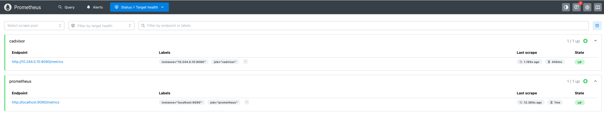

# Deploying cAdvisor and Grafana in Minikube

## Table of Contents

- [Navigate to the Application Directory](#navigate-to-the-application-directory)
- [Overview](#overview)
- [Install cAdvisor](#install-cadvisor)
- [Key Features](#key-features)
- [Integration with Prometheus](#integration-with-prometheus)
- [How It Works](#how-it-works)
- [How to Use cAdvisor with Prometheus](#how-to-use-cadvisor-with-prometheus)
- [Step 1: Running cAdvisor](#step-1-running-cadvisor)
- [Step 2: Adding Configuration to Prometheus](#step-2-adding-configuration-to-prometheus)
- [Step 3: Apply RBAC Permissions](#step-3-apply-rbac-permissions)
- [Apply Changes to Prometheus](#apply-changes-to-prometheus)
- [Use the Metric to Build a Graph](#use-the-metric-to-build-a-graph)
- [Using the Same Query in Grafana](#using-the-same-query-in-grafana)
- [Use the YAML File to Create the New Panel](#use-the-yaml-file-to-create-the-new-panel)
- [Tip for Infrastructure as Code (IaC) with Ansible](#tip-for-infrastructure-as-code-iac-with-ansible)
- [Final Objective](#final-objective)

---

## Navigate to the Application Directory

To begin, navigate to the directory for Exercise 7:

```bash
cd sre-academy-training/exercises/exercise7
````

> **Note**: This directory contains the necessary files for the exercise.
> **Important**: Before proceeding, ensure that both Minikube and Podman are running.

---

## Overview

In this exercise, we will add a new data source for Prometheus: **cAdvisor**. This integration will allow us to observe how the number of available metrics increases in Prometheus and visualize them in Grafana.


Open Prometheus with the following command:

```bash
minikube service start prometheus-service -n monitoring
```

Use this query to validate the number of metrics available:

```promql
count({__name__=~".+"})
```


---

## Install cAdvisor

### Key Features

* **Real-time monitoring**: Collects real-time performance metrics from individual containers.
* **Resource usage statistics**: Tracks CPU, memory, filesystem, and network usage.
* **Per-container statistics**: Supports container-level granularity.
* **Built-in support for Docker**: Seamlessly integrates with Docker to monitor container stats.

### Integration with Prometheus

**cAdvisor** integrates well with **Prometheus** to provide detailed container metrics. Prometheus scrapes metrics exposed by cAdvisor and stores them as time series data for analysis and alerting.

### How It Works

1. **cAdvisor runs on each Kubernetes node**: Collects metrics from containers.
2. **cAdvisor exposes metrics on an HTTP endpoint**: Typically at `/metrics` (port `8080`).
3. **Prometheus scrapes the cAdvisor endpoint**: Stores metrics for querying and visualization.

---

## How to Use cAdvisor with Prometheus

### Step 1: Running cAdvisor

Deploy cAdvisor using the provided YAML file:

```bash
kubectl apply -f cadvisor.yaml
```

Verify the cAdvisor pod status:

```bash
kubectl get pods -n monitoring
```

### Step 2: Adding Configuration to Prometheus

Update Prometheus to scrape cAdvisor metrics by adding this job definition in `prometheus.yaml`:

```yaml
- job_name: 'cadvisor'
  kubernetes_sd_configs:
    - role: pod
  relabel_configs:
    - source_labels: [__meta_kubernetes_pod_label_app]
      action: keep
      regex: cadvisor
  metrics_path: /metrics
  scheme: http
```

### Step 3: Apply RBAC Permissions

Apply the required RBAC configuration to allow Prometheus to access pod and endpoint metadata in the `monitoring` namespace:

```bash
kubectl apply -f prometheus-rbac-cluster.yaml
```

This grants the necessary `get`, `list`, and `watch` permissions for resources required by Prometheus service discovery.

---

## Apply Changes to Prometheus

Deploy the updated Prometheus configuration:

```bash
kubectl delete -f ../exercise5/prometheus.yaml # Delete the old prometheus.yaml from exercise5
kubectl apply -f prometheus.yaml # Apply the new prometheus.yaml from exercise7
```

**Note:** After applying the new configuration, Prometheus needs a moment to restart its pod. You can monitor its status to ensure it's ready before proceeding:

```bash
kubectl get pods -n monitoring -w
```

Wait until the `prometheus-deployment-...` pod shows `1/1 Running` and a recent `AGE`. Once it's ready, you can access the Prometheus UI:

```bash
minikube service prometheus-service -n monitoring
```

The **Targets** option in Prometheus should look like this:



Use this query to validate the updated metrics:

```promql
count({__name__=~".+"})
```


> If the cAdvisor integration is working, you should see an increase in the number of metrics (e.g., 5000+), indicating successful collection of container-level metrics.

---

## Use the Metric to Build a Graph

To analyze CPU usage, use this query in Prometheus:

```promql
rate(container_cpu_usage_seconds_total[5m])
```

Group results by pod:

```promql
sum(rate(container_cpu_usage_seconds_total[5m])) by (container_label_io_kubernetes_pod_name)
```


---

## Using the Same Query in Grafana

Deploy Grafana:

```bash
kubectl apply -f ../exercise6/grafana.yaml
```

> Note: After applying the Grafana configuration, the pod needs a moment to become ready. You can monitor its status:

```bash
kubectl get pods -n monitoring -w
```

Wait until the grafana-deployment-... pod shows 1/1 Running. Once it's ready, you can access the Grafana UI:

```bash
minikube service grafana-service -n monitoring
```

Log in to Grafana (`admin/admin`) and add a new panel to the existing dashboard:

1.  Navigate to **Dashboards**.
2.  Click on your existing dashboard, typically named "Example Dashboard" (or the name you previously assigned).
3.  On the dashboard, click the **Edit** button at the top of the page.
4.  Then, click the **Add** button at the top of the page, then select **Visualization**.
5.  In the "Choose Data Source" dropdown, select **Prometheus**.
6.  In the query editor section, you'll see "Query (Prometheus)". Click on the **Code** button (located next to the "Builder" button).
7.  In the "Enter a PromQL query" text area, paste the following query:

    ```promql
    sum(rate(container_cpu_usage_seconds_total[5m])) by (container_label_io_kubernetes_pod_name)
    ```

8.  Click **Run queries** to visualize the graph.
9.  Add a meaningful name to your new panel in the "Title" field (e.g., "Pod CPU Usage").
10.  Click **Save Dashboard** (usually found at the top right) to add the panel to the dashboard.
11. Finally, click **Save** to confirm changes to your existing dashboard.


---

## Use the YAML File to Create the New Panel

To automate panel creation, update the Grafana YAML configuration:

Add this block to the `grafana.yaml` file:

```yaml
"targets": [
  {
    "expr": "sum(rate(container_cpu_usage_seconds_total[5m])) by (container_label_io_kubernetes_pod_name)",
    "refId": "B"
  }
],
"title": "Pod CPU Usage",
```

Reapply the configuration:

```bash
kubectl delete -f ../exercise6/grafana.yaml
kubectl apply -f ./grafana.yaml
minikube service grafana-service -n monitoring
```

---

## Optional: Run `cluster.sh` to Deploy

If you run into issues applying resources manually (e.g., conflicting services or outdated configurations), you can use the provided `cluster.sh` script to clean and redeploy the environment:

```bash
chmod +x cluster.sh
./cluster.sh
```

This script will:

* Reapply required workloads from earlier exercises.
* Clean up Prometheus and Grafana from previous setups.
* Deploy the updated cAdvisor and Prometheus configuration.

> Use this as a recovery mechanism if the manual steps fail due to a messy Kubernetes environment.

---

## Final Objective

At the end of this exercise, you should achieve the following:

* View an updated Grafana dashboard with container metrics.
* Verify the new panel visualizing CPU usage by pod.


---