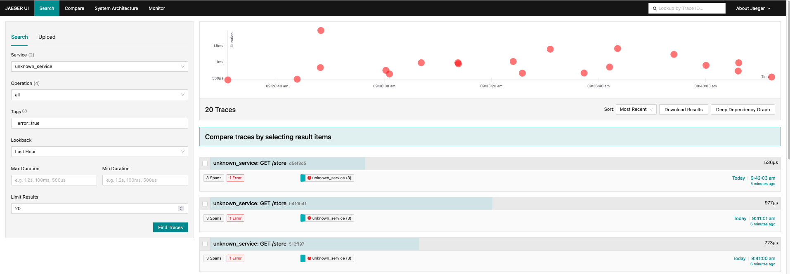
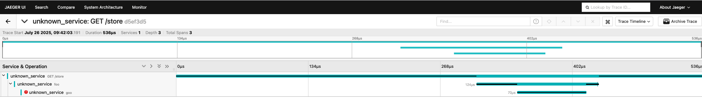
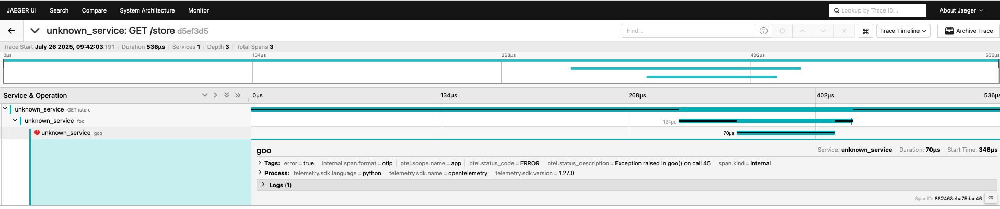

# Instrumenting a Python Application with OpenTelemetry for Distributed Tracing

## **Table of Contents**
- [Overview](#overview)
- [Navigate to the Directory](#navigate-to-the-directory)
- [Required Files](#required-files)
- [Step 1: Review the Instrumented Python Application](#step-1-review-the-instrumented-python-application)
- [Step 2: Deploy the OpenTelemetry Collector and Jaeger](#step-2-deploy-the-opentelemetry-collector-and-jaeger)
- [Step 3: Run the Instrumented Application](#step-3-run-the-instrumented-application)
- [Step 4: Automating with Ansible (Optional)](#step-4-automating-with-ansible-optional)
- [Expected Results in Jaeger UI](#expected-results-in-jaeger-ui)

---

## **Overview**
In this exercise, you will instrument a **Python application** to generate traces and send them to an **OpenTelemetry Collector (OtelCollector)**, which then forwards them to **Jaeger for visualization**. This enables **end-to-end tracing**, allowing you to analyze request flow, identify bottlenecks, and detect errors.

### **What is OpenTelemetry?**
OpenTelemetry is a framework for collecting, processing, and exporting telemetry data (metrics, traces, logs) from applications. The **OpenTelemetry Collector** acts as an intermediary that receives traces and sends them to backends like Jaeger.

### **What is Jaeger?**
Jaeger is a distributed tracing platform used to **monitor microservices-based applications**. It helps **identify bottlenecks, latency issues, and system failures** by visualizing traces from different services.

---

## **Navigate to the Directory**
Before starting, ensure you are in the correct directory:

```bash
cd sre-academy-training/exercises/exercise8
````

---

## **Required Files**

The necessary files for this exercise are already included in the repository.
You do **not** need to create them manually.

Files included:

* `otel-collector.yaml`: Configuration for the OpenTelemetry Collector.
* `jaeger.yaml`: Deployment configuration for Jaeger.
* `deployment.yaml`: Deployment configuration for the Python application.
* `app.py`: The instrumented Python application.
* `Dockerfile`: The containerization script for the Python application.

---

## **Step 1: Review the Instrumented Python Application**

This exercise comes with a **pre-instrumented Python application (`app.py`)** ready for distributed tracing. You do **not** need to modify these files manually for this exercise. The key instrumentation details are provided below for your understanding.

### **OpenTelemetry Libraries in `Dockerfile`:**

The necessary OpenTelemetry libraries for Flask instrumentation and OTLP (OpenTelemetry Protocol) gRPC export are already included:

```docker
RUN pip install flask \
    opentelemetry-api \
    opentelemetry-sdk \
    opentelemetry-exporter-otlp-proto-grpc \
    opentelemetry-instrumentation-flask
```

### **OpenTelemetry Initialization in `app.py`:**

```python
from opentelemetry import trace
from opentelemetry.exporter.otlp.proto.grpc.trace_exporter import OTLPSpanExporter
from opentelemetry.sdk.resources import Resource
from opentelemetry.sdk.trace import TracerProvider
from opentelemetry.sdk.trace.export import BatchSpanProcessor

# Define the service name
resource = Resource.create({"service.name": "sre-abc-training-app"})

# Set up the OpenTelemetry Collector endpoint
span_exporter = OTLPSpanExporter(
    endpoint="otel-collector.opentelemetry.svc.cluster.local:4317", # Points to the OtelCollector service
    insecure=True # Set to True if using an unencrypted connection
)

# Configure the tracer provider and processor
tracer_provider = TracerProvider(resource=resource)
span_processor = BatchSpanProcessor(span_exporter)
tracer_provider.add_span_processor(span_processor)
trace.set_tracer_provider(tracer_provider)

# Get a tracer instance for manual instrumentation (if needed)
tracer = trace.get_tracer(__name__)
```

The application also uses:

* `FlaskInstrumentor().instrument_app(app)` for auto-instrumentation of Flask routes
* `OpenTelemetryMiddleware` for WSGI
* Custom spans for `foo()`, `goo()`, and `zoo()` functions to demonstrate nested tracing and error capturing.

---

## **Step 2: Deploy the OpenTelemetry Collector and Jaeger**

The **OtelCollector** will collect traces from the Python application and forward them to Jaeger, which is used to visualize traces.

1. Apply the OpenTelemetry Collector and Jaeger deployments:

```bash
kubectl apply -f otel-collector.yaml
kubectl apply -f jaeger.yaml
```

2. Monitor pod status in the `opentelemetry` namespace:

```bash
kubectl get pods -n opentelemetry -w
```

Wait until both the `otel-collector-...` and `jaeger-...` pods show `1/1 Running`.

3. Access the Jaeger UI:

```bash
minikube service jaeger-service -n opentelemetry
```

> 💡 **Note:** If you see a message about "no node port" for the `jaeger` service, that’s expected. Use `jaeger-service`, which exposes the UI externally.

---

## **Step 3: Run the Instrumented Application**

Once the tracing backend is ready, deploy your Python app:

1. Apply the deployment:

```bash
kubectl apply -f deployment.yaml
```

> ⚠️ **Note:** If you encounter a `nodePort` conflict (`provided port is already allocated`), do one of the following:
>
> * Change `nodePort` in `deployment.yaml` (e.g., use `30009`)
> * Ensure previous services are deleted before starting

2. Confirm the app is running and traffic is being generated:

```bash
kubectl get pods -n application -w
```

Wait for the app pod (`sre-abc-training-app-...`) to show `1/1 Running`, and look for `store-caller-...` job pods completing, which means traces are being sent.

---

## **Step 4: Automating with Ansible (Optional)**

To automate the deployment process, you can use the included **Ansible playbook**.

### Example playbook (`deploy.yaml`):

```yaml
---
- name: Deploy OpenTelemetry Stack
  hosts: all
  become: yes
  tasks:
    - name: Apply OpenTelemetry Collector
      command: kubectl apply -f otel-collector.yaml

    - name: Apply Jaeger
      command: kubectl apply -f jaeger.yaml

    - name: Deploy Application
      command: kubectl apply -f deployment.yaml
```

Run the playbook with:

```bash
ansible-playbook -i inventory.ini deploy.yaml
```

---

## Optional: Use cluster.sh to Reset and Redeploy

If your Kubernetes environment has leftover resources from previous exercises or if you encounter deployment conflicts, you can use the provided script to clean and redeploy everything automatically:

```bash
chmod +x cluster.sh
./cluster.sh
```

This script will:

* Delete any leftover deployments from Exercise 4 and this exercise.
* Reapply the Python application, Otel Collector, and Jaeger.
* Reuse the Grafana configuration from Exercise 7 (if needed).

> Use this as a convenience script when the manual steps become repetitive or if you're troubleshooting issues in your cluster.

---

## **Expected Results in Jaeger UI**

* **Trace Dashboard**
  

* **Viewing a Specific Trace**
  

* **Tracing an Error**
  

---